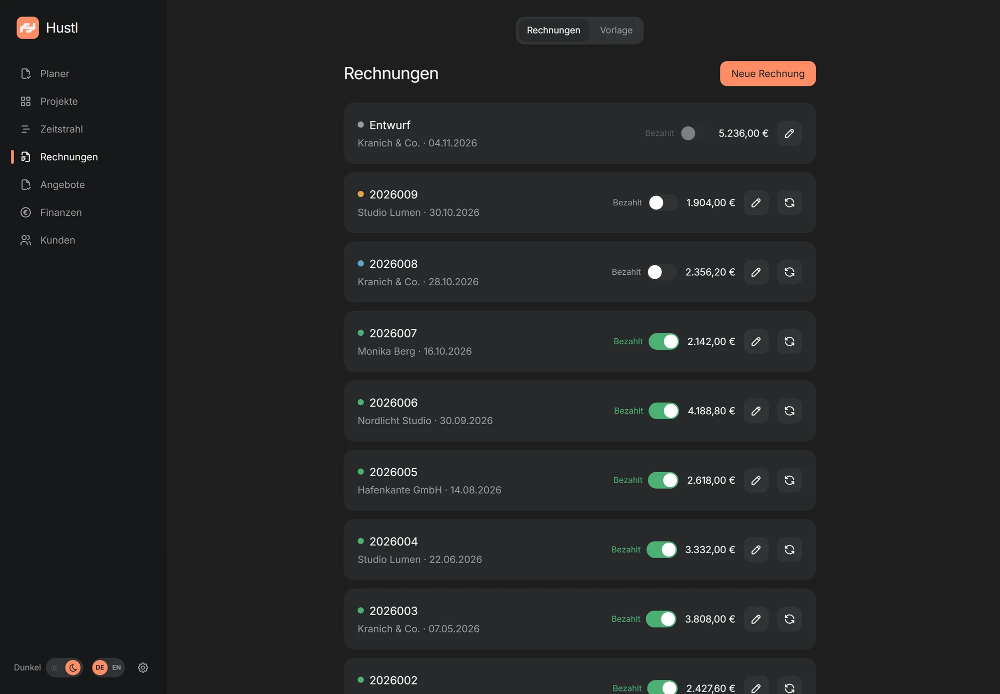

<p align="center">
  
</p>

<h1 align="center">Hustl</h1>

<p align="center">
  <a href="README.md">English</a> · <strong>Deutsch</strong>
</p>

<p align="center">
  <strong>Rechnungen, Angebote und Finanzen für Soloselbstständige.</strong><br>
  Self-hosted auf deinem eigenen Server. Keine Cloud, kein Konto, keine Telemetrie.
</p>

<p align="center">
  <a href="https://bitm4ncer.github.io/hustl/"></a>
  <a href="https://github.com/bitm4ncer/hustl/releases/latest"></a>
  <a href="LICENSE"></a>
  
</p>

---

Hustl ist eine Rechnungs- und Finanz-App für Soloselbstständige und kleine Studios in Deutschland. Sie läuft auf einem kleinen Server, den du selbst mietest. Deine Rechnungen, Kunden und Belege bleiben dort — nicht bei uns. Du nutzt Hustl im Browser, installierst es auf dem Handy als App oder nimmst die Desktop-App für Windows, macOS und Linux.

<p align="center">
  <a href="https://bitm4ncer.github.io/hustl/"><strong>Website & Screenshots →</strong></a>
</p>

## Für wen ist Hustl?

Hustl passt zu dir, wenn du:

- als Freelancer arbeitest oder ein kleines Studio führst,
- Rechnungen, Angebote, Projekte und Finanzen an einem Ort haben willst,
- deine Daten auf deinem eigenen Server haben willst statt in einer fremden Cloud,
- mit einem kleinen Server einverstanden bist, der etwa **5–10 € im Monat** kostet.

Hustl ist **nicht** das Richtige, wenn du eine Team-Plattform mit mehreren Benutzern brauchst, einen komplett gehosteten Dienst ohne Einrichtung willst oder vollständig offline arbeiten musst.

## Was Hustl kann

- **Rechnungen** — schreiben, nummerieren, finalisieren und als PDF herunterladen.
- **E-Rechnung** — hybride PDF/A-3-Dateien nach EN 16931 (ZUGFeRD / Factur-X).
- **Angebote** — Versionen, Status und PDF; ein angenommenes Angebot wird zu Kunde und Projekt.
- **Kunden und Projekte** — Stundensätze, Fixpreise, Positionen und offene Posten.
- **Finanzen** — Einnahmen, Ausgaben, Fixkosten, Dashboard, Prognose und Monatsexport.
- **Belege und Kontoauszüge** — PDFs hochladen und Zahlungen den Rechnungen zuordnen.
- **To-dos** — Kategorien für Aufgaben, Einkäufe, Lebensmittel und Weeklys.
- **Deutsch und Englisch** als Oberflächen- und Rechnungssprache, mit 12 Währungen.
- **Vollarchiv** — ein ZIP mit Datenbank, allen PDFs und CSV-Dateien.

## So sieht es aus

<p align="center">
  <br>
  <sub>Demo-Daten — alle Namen, Adressen und Beträge sind erfunden.</sub>
</p>

<p align="center">
  <a href="https://bitm4ncer.github.io/hustl/"><strong>Mehr Screenshots auf der Website →</strong></a>
</p>

## In drei Schritten starten

Du brauchst zwei Dinge: einen kleinen Server (einen **VPS**, also einen gemieteten Computer) und eine Domain, die darauf zeigt. Ein VPS mit 2 GB RAM reicht und kostet ungefähr 5–10 € im Monat.

### 1. Server und Domain besorgen

Nimm Debian 12/13 oder Ubuntu 22.04/24.04 mit mindestens 2 vCPU, 2 GB RAM und 10 GB freiem Speicher. Richte die A- und AAAA-Records einer Domain wie `hustl.example.com` auf den Server. Die Ports 22, 80 und 443 müssen offen sein.

Wenn du das noch nie gemacht hast: Der [Agenten-Leitfaden](INSTALL-WITH-AGENT.md) führt dich Schritt für Schritt durch, inklusive VPS-Auswahl und DNS.

### 2. Installer starten

Verbinde dich per SSH mit dem Server und führe aus:

```bash
sudo mkdir -p /opt/hustl
sudo chown "$USER":"$USER" /opt/hustl
git clone https://github.com/bitm4ncer/hustl.git /opt/hustl/src
cd /opt/hustl/src
sudo ./deploy/selfhost/install.sh
```

Der Installer fragt nach deiner Domain und einer E-Mail-Adresse für das HTTPS-Zertifikat. Danach baut er Hustl, startet Docker und richtet HTTPS, Autostart und ein tägliches Backup um 03:30 ein.

### 3. Passkey anlegen

Öffne den Setup-Link, den der Installer ausgibt:

```text
https://<deine-domain>/setup?token=…
```

Lege deinen ersten Passkey an — Face ID, Touch ID, Windows Hello oder ein Sicherheitsschlüssel — und bewahre die **zehn Recovery-Codes** sicher auf. Der Setup-Link funktioniert nur einmal.

Das war's. Öffne `https://<deine-domain>` im Browser und leg los.

> **Schon ein Webserver auf Port 80/443?** Der Installer erkennt das und schaltet in den `external`-Modus. Hustl lauscht dann nur auf `127.0.0.1:3000`; einen fertigen Proxy-Block schreibt er nach `/opt/hustl/Caddyfile.snippet`. Erzwingen lässt sich der Modus mit `HUSTL_PROXY=external`. Läuft Caddy selbst als Container, nutze `HUSTL_PROXY=external PROXY_NETWORK=web` und `/opt/hustl/Caddyfile.docker.snippet`.

## Mit einem Agenten installieren

Wenn du die Befehle nicht selbst tippen willst, öffne [`INSTALL-WITH-AGENT.md`](INSTALL-WITH-AGENT.md) und kopiere den Prompt in deinen KI-Assistenten. Der Agent fragt nach VPS, SSH-Zugang, Domain, Firewall und Backups und begleitet dich durch jeden Schritt. Der Leitfaden ist auf Deutsch.

## Desktop-App herunterladen

Die Desktop-App ist eine schlanke Electron-Hülle um dieselbe Web-Oberfläche. Beim ersten Start fragt sie nach deiner Server-URL.

| Plattform | Download | Hinweis |
|---|---|---|
| Windows | [Hustl für Windows](https://github.com/bitm4ncer/hustl/releases/latest/download/Hustl-win.exe) | Installer, 64-bit |
| macOS (Apple Silicon) | [Hustl für macOS arm64](https://github.com/bitm4ncer/hustl/releases/latest/download/Hustl-mac-arm64.dmg) | M1–M4 |
| macOS (Intel) | [Hustl für macOS x64](https://github.com/bitm4ncer/hustl/releases/latest/download/Hustl-mac-x64.dmg) | Intel-Macs |
| Linux | [Hustl für Linux](https://github.com/bitm4ncer/hustl/releases/latest/download/Hustl-linux.AppImage) | AppImage, x86_64 |

Oder alle [Releases auf GitHub](https://github.com/bitm4ncer/hustl/releases/latest) ansehen.

Die Builds sind **unsigniert**. Beim ersten Start musst du sie deshalb einmal freigeben:

- **Windows:** „Weitere Informationen“ → „Trotzdem ausführen“.
- **macOS:** Rechtsklick auf die App → „Öffnen“ → „Öffnen“, oder `xattr -dr com.apple.quarantine /Applications/Hustl.app`.
- **Linux:** `chmod +x Hustl-linux.AppImage && ./Hustl-linux.AppImage`.

### PWA: ganz ohne Download

Die PWA ist der einfachste Weg, Hustl auf jedem Gerät zu nutzen:

1. Öffne deine Hustl-URL im Browser und melde dich per Passkey an.
2. Wähle in Chrome/Edge **App installieren** oder in Safari auf dem iPhone **Zum Home-Bildschirm**.
3. Die App startet ohne Browser-Leiste und entsperrt mit Face ID oder Windows Hello.

Das funktioniert auf Windows, macOS, Linux, iPhone, iPad und Android.

## Was kostet Hustl?

Hustl ist kostenlos und Open Source unter der ISC-Lizenz. Es gibt kein Abo und keine Lizenzgebühr.

| Posten | Typische Kosten |
|---|---|
| Hustl | 0 € |
| VPS (2 GB RAM) | 5–10 € / Monat |
| Domain | etwa 1 € / Monat |

Du bezahlst direkt deinen Server-Anbieter. Hustl sieht deine Rechnungen und Kundendaten nie.

## Häufige Fragen

**Muss ich technisch sein?**
Ein bisschen. Du musst drei Befehle kopieren und eine Domain auf deinen Server zeigen lassen. Wenn dir das unangenehm ist, nimm den [Agenten-Leitfaden](INSTALL-WITH-AGENT.md) — er stellt die Fragen und führt dich durch die Installation. Du kannst auch jemanden aus deinem Umfeld fragen; die Installation ist eine einmalige Sache.

**Wo liegen meine Daten?**
In einer SQLite-Datenbank und als PDFs auf deinem eigenen Server. Es gibt keine Cloud, kein Konto bei uns und keine Analytics. Backups verlassen den Server nur, wenn du selbst ein Offsite-Ziel wie restic einrichtest.

**Kann ich Hustl auf dem Handy nutzen?**
Ja, als PWA: Öffne die URL in Safari, tippe auf „Teilen“ und wähle „Zum Home-Bildschirm“. Die Anmeldung läuft über Face ID oder Touch ID. Eine App-Store-App gibt es nicht.

**Was ist ein Passkey?**
Ein Login ohne Passwort, mit Face ID, Touch ID, Windows Hello oder einem Sicherheitsschlüssel. Weitere Geräte kannst du später mit einem Recovery-Code hinzufügen. Bewahre die zehn Recovery-Codes getrennt von Handy oder Laptop auf.

**Ist das sicher?**
Hustl nutzt WebAuthn-Passkeys, HttpOnly-Session-Cookies, CSRF-Schutz und Rate-Limits. HTTPS übernimmt Caddy im gebündelten Setup. Für Server-Updates und Backups bist du selbst verantwortlich; der Installer legt täglich einen SQLite-Snapshot an.

**Kann ich meine Daten exportieren?**
Ja. Du kannst ein Vollarchiv als ZIP mit Datenbank, allen PDFs und CSV-Dateien herunterladen. Für die Steuerberatung gibt es zusätzlich einen Monatsexport.

**Kann ich Daten aus einem anderen Tool importieren?**
Kontoauszüge und Beleg-PDFs lassen sich importieren. Einen universellen Ein-Klick-Import für Rechnungen aus anderen Tools gibt es nicht; ein Umzug braucht meist ein kleines Skript oder etwas Handarbeit.

**Unterstützt Hustl E-Rechnung?**
Ja. Hustl erzeugt hybride PDF/A-3-Dateien nach EN 16931 (ZUGFeRD / Factur-X). Vor dem ersten echten Versand sollte eine Beispielrechnung mit dem offiziellen KoSIT-Validator geprüft werden: Die Bibliothek prüft die XML-Struktur, nicht jede Geschäftsregel.

**Gibt es eine gehostete Version?**
Nein. Hustl ist bewusst self-hosted, damit deine Daten bei dir bleiben. Du kannst es auf einem Server deiner Wahl betreiben, auch bei einem Hosting-Anbieter.

## Gut zu wissen

- **Ein Benutzer.** Hustl ist bewusst keine Multi-Tenant-Plattform.
- **Der Server muss online sein.** Es gibt keinen Offline-Schreibbetrieb; der Server ist die einzige Datenquelle.
- **Einige Funktionen sind lokal.** E-Mail-Versand per SMTP, GoCardless-Banksync, Notion-Import und der Vorlagen-Editor auf dem Smartphone gibt es nur im lokalen Electron-Entwicklungsbetrieb. Der verpackte Desktop-Client lädt dieselbe Web-Oberfläche.
- **Unsignierte Builds.** Windows SmartScreen und macOS Gatekeeper brauchen beim ersten Start eine Freigabe.
- **Backup ist Pflicht.** Ohne funktionierendes Backup gibt es keinen zweiten Datenstand.
- **E-Rechnung braucht einen Test.** Prüfe eine Beispielrechnung mit dem KoSIT-Validator, bevor du echte E-Rechnungen versendest.

## Technische Details

<details>
<summary><strong>Voraussetzungen und ausführliche Installation</strong></summary>

| | |
|---|---|
| Server | 2 vCPU, mindestens 2 GB RAM (4 GB empfohlen), 10 GB freier Platz |
| System | Debian 12/13 oder Ubuntu 22.04/24.04, x86_64 oder arm64 |
| Domain | z. B. `hustl.example.com`, A- und AAAA-Record auf den VPS |
| Ports | 22 (SSH), 80 und 443 offen |
| Zugang | SSH-Zugang mit Key oder Passwort |
| Werkzeuge | `git` für den Clone; `curl` installiert der Installer bei Bedarf nach |

Der Installer kennt zwei Modi:

- **`bundled`** (Standard, wenn Ports 80/443 frei sind): Hustl plus Caddy mit automatischem HTTPS.
- **`external`** (wenn schon ein Webserver läuft): Hustl lauscht auf `127.0.0.1:3000`, du leitest per Proxy weiter.

Nicht-interaktive Installation:

```bash
sudo HUSTL_DOMAIN=hustl.example.com \
     ACME_EMAIL=du@example.com \
     HUSTL_ASSUME_YES=1 \
     ./deploy/selfhost/install.sh
```

Nützliche Umgebungsvariablen: `HUSTL_DOMAIN`, `ACME_EMAIL`, `HUSTL_PROXY`, `HUSTL_DIR`, `HUSTL_PORT`, `PROXY_NETWORK`, `HUSTL_ASSUME_YES`.

Nach der Installation:

| Aufgabe | Wo |
|---|---|
| Anmelden | `https://<deine-domain>` |
| Erststart / Passkey | `https://<deine-domain>/setup?token=…` |
| Weiteres Gerät hinzufügen | Login → „Passkey verloren?“ → Recovery-Code |
| Vollarchiv herunterladen | Einstellungen → Daten → „Archiv herunterladen“ |
| Logs | `docker logs -f hustl` |
| Caddy-Logs | `docker logs -f hustl-caddy` |
| Daten | `/opt/hustl/data` |
| Konfiguration | `/opt/hustl/.env` |

</details>

<details>
<summary><strong>Updates, Backups, Restore und Domainwechsel</strong></summary>

### Update

```bash
cd /opt/hustl/src
git pull
sudo ./deploy/selfhost/install.sh
```

Der Installer baut das Image neu, startet die Container neu und lässt Daten sowie `.env` unangetastet.

### Backup

Der Installer richtet einen systemd-Timer ein, der täglich um 03:30 einen konsistenten SQLite-Snapshot erzeugt:

```bash
sudo /opt/hustl/backup.sh
systemctl status hustl-backup.timer
```

Die Snapshots liegen unter `/opt/hustl/data/backups` (sieben Stück, von der App rotiert) und als Kopie unter `/opt/hustl/backups` (14 Tage). Für ein Offsite-Backup kann `backup.sh` restic verwenden:

```bash
sudo RESTIC_REPOSITORY=sftp:hustl-backup:/ \
     RESTIC_PASSWORD_FILE=/etc/hustl/restic.pass \
     /opt/hustl/backup.sh
```

### Restore

```bash
# Nur prüfen, nichts verändern
sudo /opt/hustl/restore.sh --check /opt/hustl/backups/hustl-2026-11-04.db

# Wirklich zurückspielen (Container wird gestoppt)
sudo /opt/hustl/restore.sh /opt/hustl/backups/hustl-2026-11-04.db
```

Die aktuelle Datenbank wird vorher als `hustl.db.before-<zeitstempel>` gesichert. Ein Restore ohne geprüftes Backup ist keine gute Idee.

### Domain wechseln

Passkeys sind an die Domain gebunden. Ein Wechsel von `HUSTL_DOMAIN` macht alle bisherigen Passkeys ungültig. Danach ist ein Reset nötig:

```bash
docker exec hustl node dist/server/cli.mjs reset-auth
```

Der neue Bootstrap-Token steht in `/opt/hustl/data/bootstrap-token.txt`.

### Passkey verloren?

Wenn noch ein weiterer Passkey existiert: einfach damit anmelden. Wenn nicht, bleibt nur der Reset über die Shell (siehe oben). Deshalb: **Recovery-Codes getrennt vom Gerät aufbewahren** und bei Bedarf ein zweites Gerät über einen Code hinzufügen.

</details>

<details>
<summary><strong>Technik und Entwicklung</strong></summary>

- **Stack:** Electron 42, TypeScript, React 19, Vite 7, Tailwind 3
- **Server:** Fastify 5, `node:sqlite` (keine nativen Abhängigkeiten), Chromium für PDF, `node-zugferd` für E-Rechnungen
- **Betrieb:** Docker, non-root-Container, read-only Rootfs, 1-GB-Speicherlimit, kein nach außen veröffentlichter Port im `bundled`-Modus
- **Sicherheit:** WebAuthn-Passkeys, HttpOnly-Session-Cookies, CSRF-Schutz und Rate-Limits; TLS über den Reverse Proxy (Caddy im `bundled`-Modus)
- **Daten:** `/data/hustl.db`, PDFs unter `/data/invoices`, `/data/offers`, `/data/expenses`, `/data/statements`, Vorlagen unter `/data/template`
- **Backup:** SQLite-Snapshot plus Dateien; optional restic mit clientseitiger Verschlüsselung

```text
src/
├─ core/        DB, Export, Import, Bank, Belege (ohne Electron)
├─ server/      Fastify, Auth, RPC, Dateien, Archiv
├─ renderer/    React-UI und PWA
├─ main/        Electron-Shell und Erststart-Dialog
└─ shared/      Typen und reine Logik
deploy/
├─ Dockerfile
└─ selfhost/    Installer, Compose, Caddy, Backup, Restore
```

Vorausgesetzt ist Node 24 oder neuer.

```bash
npm install

npm run dev          # Electron mit lokalem IPC (Entwicklung)
npm run build:web    # PWA nach dist/web bauen
npm run dev:server   # Fastify auf :3000 (nach build:web)
npm run icons        # PWA-Icons und build/icon.icns neu erzeugen
npm test             # Unit-Tests mit Vitest
npm run test:e2e     # Playwright gegen die laufende Instanz
```

Installer bauen (jeweils auf dem Zielsystem bzw. in CI):

```bash
npm run dist:win     # Windows NSIS
npm run dist:mac     # macOS DMG (x64 + arm64)
npm run dist:linux   # Linux AppImage
```

Der Release-Workflow `.github/workflows/release.yml` baut alle drei Pakete bei einem Tag `v*` und hängt sie an das GitHub-Release. Die Landingpage liegt in `site/` und wird von `.github/workflows/pages.yml` auf GitHub Pages veröffentlicht.

</details>

## Datenschutz

Deine Rechnungen, Kunden und Belege liegen auf deinem Server — nicht bei Hustl. Es gibt keine Analytics, keine Telemetrie und kein Benutzerkonto bei einem Drittanbieter. Die Anmeldung erfolgt per Passkey; es wird kein Passwort gespeichert. Backups verlassen den Server nur, wenn du restic oder ein anderes Offsite-Ziel einrichtest — dann clientseitig verschlüsselt.

## Lizenz

[ISC](LICENSE). Hustl ist ein persönliches Projekt, das aktiv weiterwächst.
